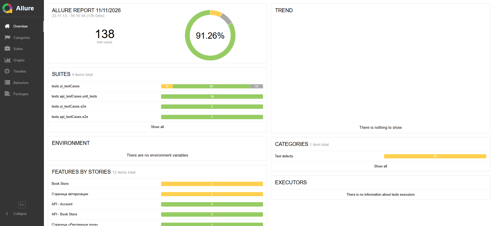
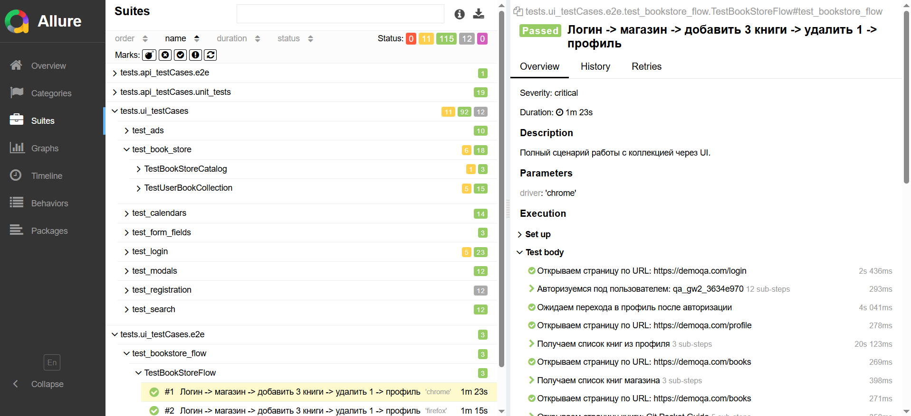

# VolgaIT QA Final 2026

Автотесты для тренажёра [demoqa.com](https://demoqa.com): UI-сценарии Book Store
и API-тесты Account / BookStore.

Проект покрывает регистрацию (API), авторизацию, работу с коллекцией книг,
получение списков книг из профиля и магазина, поиск по магазину, а также
E2E-сценарии для UI и API.

## Стек

- Python 3.14
- Selenium 4 (Chrome, Firefox, Edge)
- Pytest + pytest-xdist
- Allure (`allure-pytest`)
- Requests + Pydantic (API-слой)
- Page Object Model + PageFactory
- API: BaseEndpoint → endpoints → FactoryEndpoint, клиенты, pydantic-схемы

## Структура проекта

```text
api_Services/
  api/                       # BaseEndpoint, эндпоинты, FactoryEndpoint
  clients/                   # BaseClient, UserClient, BookClient
  schemas/                   # UserSchema, BookSchema, base_schema, ErrorResponse
data/
  api_data/                  # http_method_enum, JSON-шаблоны payload'ов
  ui_data/                   # URL, локаторы, ожидаемые данные, mock-данные
utils/
  api/                       # validators, generators, payload builders
  ui/                        # wait helpers
UI_Service/pages/            # Page Object'ы + фабрика страниц
tests/
  api_testCases/
    unit_tests/              # тесты эндпоинтов API
    e2e/                     # E2E API-сценарий
  ui_testCases/
    e2e/                     # E2E UI-сценарий
    test_login.py
    test_book_store.py
    test_search.py
    test_registration.py     # пропущен (см. «Известные ограничения»)
config.py                    # UI/API-конфигурация
conftest.py                  # фикстуры UI/API, скриншоты при падении
pytest.ini
```

## Установка и запуск

1. Создать и активировать окружение:

    ```powershell
    python -m venv .venv
    .venv\Scripts\activate
    ```

2. Установить зависимости:

    ```powershell
    pip install -r requirements.txt
    ```

3. Запустить тесты:

    ```powershell
    pytest -v
    ```

### Полезные команды

| Что запустить                      | Команда                                                             |
| ---------------------------------- | ------------------------------------------------------------------- |
| Все API-тесты                      | `pytest tests/api_testCases -v`                                     |
| API-тесты параллельно              | `pytest tests/api_testCases -n 4 -v`                                |
| Все UI-тесты (Chrome)              | `pytest tests/ui_testCases -k chrome -v`                            |
| Все UI-тесты (Chrome/Firefox/Edge) | `pytest tests/ui_testCases -v`                                      |
| E2E UI                             | `pytest tests/ui_testCases/e2e -v`                                  |
| E2E API                            | `pytest tests/api_testCases/e2e -v`                                 |
| E2E UI + API                       | `pytest tests/ui_testCases/e2e tests/api_testCases/e2e -v`          |
| Конкретный файл                    | `pytest tests/ui_testCases/test_search.py -v`                       |
| Отчёт Allure                       | `pytest --alluredir=allure-results` + `allure serve allure-results` |

При падении UI-теста скриншот автоматически прикрепляется к Allure-отчёту.

### Кроссбраузерность

Фикстура `driver` параметризована браузерами `chrome`, `firefox`, `edge`.
Каждый UI-тест выполняется в трёх браузерах (если они установлены в системе).
Для браузеров задаются собственные `Options`, стратегия загрузки `eager`,
таймаут загрузки страницы 60 секунд.

Выбрать один браузер можно через `-k`:

```powershell
pytest tests/ui_testCases -k chrome -v
pytest tests/ui_testCases/e2e -k firefox -v
```

Браузеры и headless-режим управляются переменными окружения:

| Переменная | По умолчанию | Назначение |
|---|---|---|
| `BROWSERS` | `chrome,firefox,edge` | Список браузеров через запятую |
| `HEADLESS` | `1`, если задан `CI`, иначе `0` | Запуск без графического интерфейса |

Пример для сервера/CI:

```bash
HEADLESS=1 BROWSERS=chrome pytest tests/ui_testCases -n 2 -v
```

```powershell
$env:HEADLESS="1"; $env:BROWSERS="chrome"; pytest tests/ui_testCases -n 2 -v
```

Если браузер не установлен в системе, его тесты автоматически пропускаются.

## CI/CD

Workflow: `.github/workflows/run_tests.yml`.

- **UI-Tests** — Ubuntu, Python 3.12, headless Chrome (`HEADLESS=1`,
  `BROWSERS=chrome`), запуск `pytest tests/ui_testCases -n 2`, выгрузка
  Allure-результатов артефактом.
- **API-Tests** — Ubuntu, Python 3.12, запуск `pytest tests/api_testCases -n 2`,
  выгрузка Allure-результатов артефактом.

В CI выбран только Chrome: он гарантированно доступен на `ubuntu-latest` и
стабильно работает в headless-режиме. Кроссбраузерный прогон
(Chrome/Firefox/Edge) выполняется локально; при необходимости список браузеров
в CI расширяется переменной `BROWSERS`.

Количество воркеров при `-n auto` ограничено 4 через
`pytest_xdist_auto_num_workers`, чтобы не перегружать раннер браузерами.

## Тестовые данные и фикстуры

- `session_user` — уникальный пользователь на каждый xdist-воркер, создаётся
  через API (`Account/v1/User`). Используется UI-тестами.
- `api_user` — новый пользователь для каждого API-теста (регистрация + токен).
- `empty_collection` — очищает коллекцию книг перед UI-сценарием.
- `api_clean_books` — удаляет книги через API после теста.
- `store_books` — список книг магазина из API.
- `user_client`, `book_client`, `endpoint_factory` — клиенты и фабрика API.

Каждый API-тест работает со своим пользователем, поэтому тесты не мешают друг
другу при параллельном запуске.

## Покрытые сценарии

### UI: авторизация (`test_login.py`)

| ID         | Сценарий                                | Ожидаемый результат                           |
| ---------- | --------------------------------------- | --------------------------------------------- |
| UI-AUTH-01 | Открытие страницы логина                | Заголовок Login отображается                  |
| UI-AUTH-02 | Вход с валидными данными                | Переход в профиль, имя пользователя совпадает |
| UI-AUTH-03 | Вход с неверным паролем                 | Ошибка «Invalid username or password!»        |
| UI-AUTH-04 | Вход незарегистрированного пользователя | Ошибка «Invalid username or password!»        |
| UI-AUTH-05 | Пустые логин и пароль                   | Вход не выполняется, остаёмся на /login       |
| UI-AUTH-06 | Кнопка New User                         | Открывается страница регистрации              |
| UI-AUTH-07 | Выход из аккаунта                       | Возврат на страницу авторизации               |

### UI: магазин и коллекция (`test_book_store.py`)

| ID         | Сценарий                   | Ожидаемый результат                                                 |
| ---------- | -------------------------- | ------------------------------------------------------------------- |
| UI-BOOK-01 | Список книг магазина       | 8 книг, данные совпадают с ожидаемыми                               |
| UI-BOOK-02 | Добавление одной книги     | Alert «Book added to your collection.» и книга в профиле            |
| UI-BOOK-03 | Добавление трёх книг       | Все книги отображаются в профиле                                    |
| UI-BOOK-04 | Повторное добавление книги | Alert «Book already present in the your collection!», дубликата нет |
| UI-BOOK-05 | Удаление одной книги       | Alert «Book deleted.», остальные книги остаются                     |
| UI-BOOK-06 | Удаление нескольких книг   | Все добавленные книги удалены, профиль пуст                         |

### UI: поиск (`test_search.py`)

| ID           | Сценарий           | Ожидаемый результат                           |
| ------------ | ------------------ | --------------------------------------------- |
| UI-SEARCH-01 | Поиск «Git»        | Только «Git Pocket Guide»                     |
| UI-SEARCH-02 | Поиск «git»        | Регистронезависимый поиск, «Git Pocket Guide» |
| UI-SEARCH-03 | Поиск «JavaScript» | 4 книги с JavaScript в названии               |
| UI-SEARCH-04 | Поиск «zzzz»       | Список пуст                                   |

### UI: E2E (`tests/ui_testCases/e2e/test_bookstore_flow.py`)

| ID        | Сценарий                                                                       |
| --------- | ------------------------------------------------------------------------------ |
| UI-E2E-01 | Логин → магазин → добавить 3 книги → удалить одну → проверить список в профиле |

Сценарий выполняется в Chrome, Firefox и Edge, коллекция очищается до и после
теста.

### API: регистрация (`test_register_endpoint.py`)

| ID         | Сценарий              | Ожидаемый результат                           |
| ---------- | --------------------- | --------------------------------------------- |
| API-REG-01 | Успешная регистрация  | 201, `userID`, `username`, пустой список книг |
| API-REG-02 | Повторная регистрация | 406, код `1204`, «User exists!»               |
| API-REG-03 | Невалидный пароль     | 400, код `1300`, сообщение о политике пароля  |

### API: авторизация (`test_login_endpoint.py`)

| ID          | Сценарий                      | Ожидаемый результат                  |
| ----------- | ----------------------------- | ------------------------------------ |
| API-AUTH-01 | Генерация токена              | 200, `status=Success`, токен получен |
| API-AUTH-02 | Неверный пароль               | 200, `status=Failed`, токена нет     |
| API-AUTH-03 | Пустой запрос токена          | 400, код `1200`                      |
| API-AUTH-04 | Проверка Authorized           | 200, `true`                          |
| API-AUTH-05 | Authorized с неверным паролем | 404, код `1207`, «User not found!»   |

### API: магазин (`test_store_books_endpoint.py`)

| ID           | Сценарий                       | Ожидаемый результат                          |
| ------------ | ------------------------------ | -------------------------------------------- |
| API-STORE-01 | Получение списка книг магазина | 200, 8 книг, уникальные ISBN, поля заполнены |

### API: добавление книг (`test_add_books_endpoint.py`)

| ID         | Сценарий               | Ожидаемый результат             |
| ---------- | ---------------------- | ------------------------------- |
| API-ADD-01 | Добавление одной книги | 201, книга в ответе и в профиле |
| API-ADD-02 | Добавление трёх книг   | 201, все книги в профиле        |
| API-ADD-03 | Повторное добавление   | 400, код `1210`                 |
| API-ADD-04 | Несуществующий ISBN    | 400, код `1205`                 |
| API-ADD-05 | Добавление без токена  | 401, код `1200`                 |

### API: удаление книг (`test_delete_book_endpoint.py`)

| ID         | Сценарий                       | Ожидаемый результат            |
| ---------- | ------------------------------ | ------------------------------ |
| API-DEL-01 | Удаление одной книги           | 204, книга исчезает из профиля |
| API-DEL-02 | Удаление книги не из коллекции | 400, код `1206`                |
| API-DEL-03 | Удаление без токена            | 401, код `1200`                |

### API: профиль (`test_profile_books_endpoint.py`)

| ID             | Сценарий                       | Ожидаемый результат                              |
| -------------- | ------------------------------ | ------------------------------------------------ |
| API-PROFILE-01 | Профиль с добавленными книгами | 200, совпадают `userId`, `username`, список книг |
| API-PROFILE-02 | Профиль без токена             | 401, код `1200`                                  |

### API: E2E (`tests/api_testCases/e2e/test_bookstore_lifecycle.py`)

| ID         | Сценарий                                                                            |
| ---------- | ----------------------------------------------------------------------------------- |
| API-E2E-01 | Регистрация → логин → магазин → добавить 3 книги → удалить одну → проверить профиль |

## API-конфигурация

Базовый URL API — `https://demoqa.com` (документация Swagger:
`https://demoqa.com/swagger`).

| Метод  | Endpoint                    | Назначение                   |
| ------ | --------------------------- | ---------------------------- |
| POST   | `/Account/v1/User`          | Регистрация                  |
| POST   | `/Account/v1/GenerateToken` | Получение токена             |
| POST   | `/Account/v1/Authorized`    | Проверка авторизации         |
| GET    | `/Account/v1/User/{userId}` | Профиль и книги пользователя |
| GET    | `/BookStore/v1/Books`       | Список книг магазина         |
| POST   | `/BookStore/v1/Books`       | Добавление книг в коллекцию  |
| DELETE | `/BookStore/v1/Book`        | Удаление книги из коллекции  |

Тела ответов валидируются pydantic-схемами, ошибочные ответы — схемой
`ErrorResponseSchema` (`code`, `message`).

## Скриншоты Allure-отчёта

Общий отчёт: 138 тест-кейсов, 91.26% успешных, разбивка по наборам
(UI, API unit, UI E2E, API E2E).



Пример E2E-теста «Логин → магазин → добавить 3 книги → удалить 1 → профиль»
в Chrome: пройден, шаги визуализированы в Allure.



## Известные ограничения

1. **Регистрация через UI пропущена.** Demoqa сбрасывает поля формы в момент
   инициализации reCAPTCHA, из-за чего UI-регистрация нестабильна. Тесты
   регистрации помечены `skip`; регистрация и авторизация покрыты API-тестами.
2. **Троттлинг demoqa при высоком параллелизме.** При `-n auto` и запуске всех
   UI-тестов на трёх браузерах сайт может отвечать `429`/обрывать соединения
   (`ReadTimeout`), а фронтенд — молча не показывать ошибку/alert. Для
   стабильного прогона используйте `-n 4` или запускайте UI по одному браузеру
   (`-k chrome`). Повторный запуск обычно проходит.
3. **Рекламные оверлеи.** Клики могут перехватываться рекламой/футером. В
   `BasePage.click` реализованы прокрутка к центру, повтор и JS-клик; для
   добавления/удаления книг добавлены повторные попытки.
4. **Кнопка Delete All Books** на demoqa имеет дефект: `DELETE` возвращает 204,
   но UI не обновляется. Тесты удаляют книги по одной.
5. **Поиск** фильтрует по названию книги. Для каждого запроса открывается
   чистая страница магазина, чтобы не зависеть от состояния React-поля.
6. Для кроссбраузерного прогона должны быть установлены Chrome, Firefox и Edge;
   драйверы подтягиваются Selenium Manager.
7. API-тесты ходят на публичный demoqa и создают уникальных пользователей на
   каждый тест; повторные прогоны не конфликтуют, но требуют сети.
